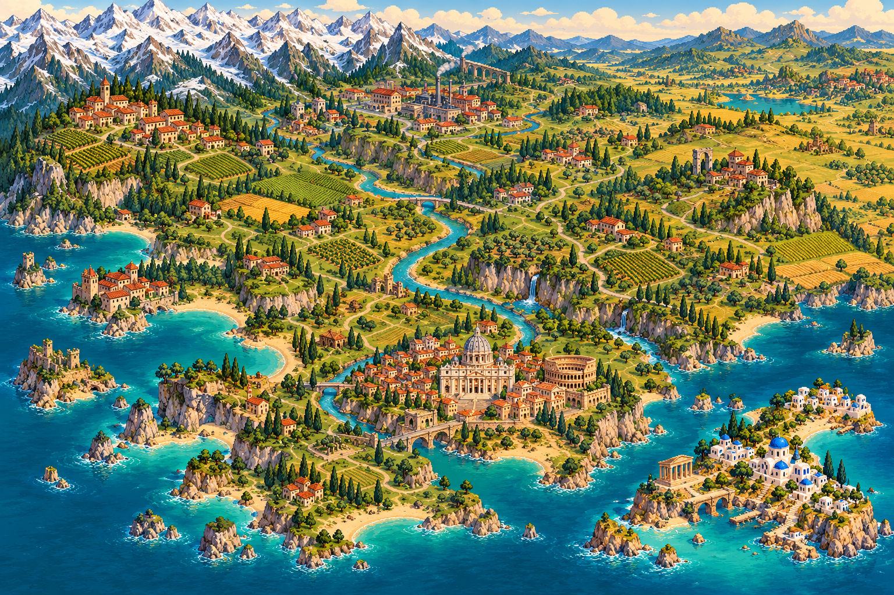
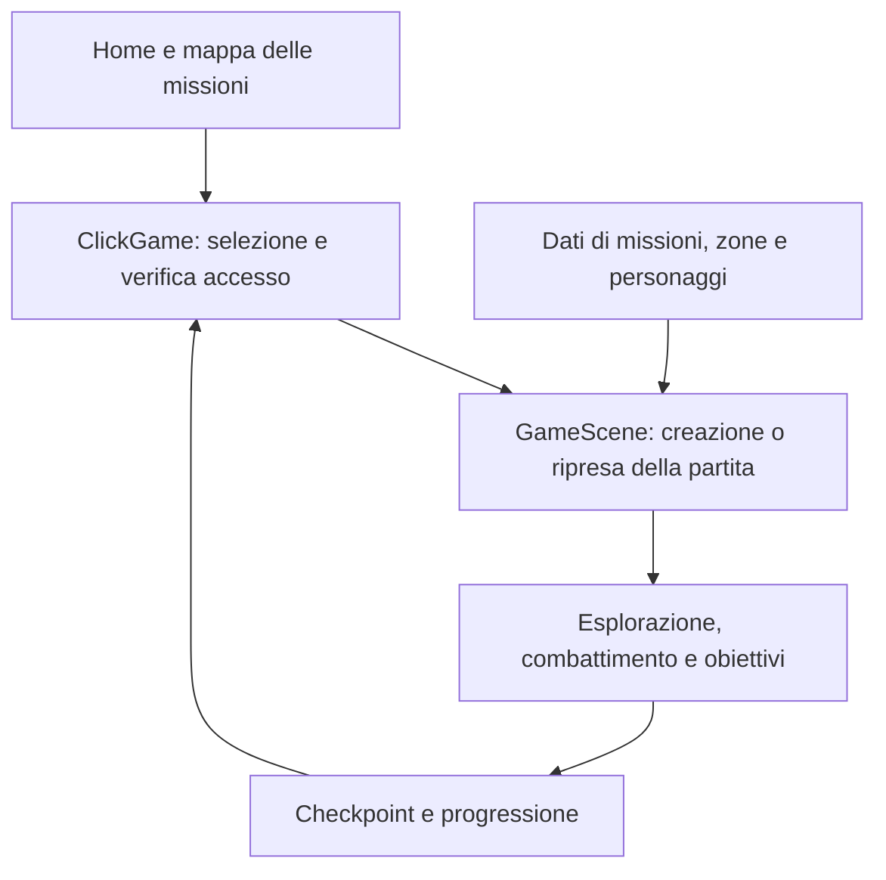

# GTA CLick — L’Immortale

### Fossano non era pronta. Il browser nemmeno.

**Un’avventura arcade 2D nata per il trentesimo compleanno di Klaudio: una banda di amici, dieci missioni e una quantità discutibile di buone idee.**

[🎮 Gioca nel browser](https://tedibash.github.io/gta-IV-click-l-immortale/) · [🚀 Avvio locale](#avvio-locale) · [🧩 Architettura](#architettura-del-codice) · [🛠️ Sviluppo](#come-estendere-il-gioco)

**10 missioni · 31 capitoli · 11 personaggi giocabili · 4 difficoltà · Desktop e touch**



## Da un regalo a un videogioco

Questo progetto nasce dall’idea di trasformare amici, battute e situazioni personali in un videogioco dedicato a **Klaudio, detto Click l’Immortale**, grande appassionato di PlayStation.

Prima sono arrivati il racconto, le illustrazioni, il manuale cartaceo e la copertina del gioco. Poi quel mondo è diventato un’avventura giocabile nel browser: un omaggio all’immaginario di GTA, reinterpretato con visuale dall’alto, comandi da console portatile e atmosfere da action RPG dell’epoca Game Boy Advance.

Il risultato unisce esplorazione, combattimenti, guida e dialoghi illustrati. I personaggi hanno talenti diversi, le missioni attraversano ambienti collegati e le scene del manuale accompagnano i momenti importanti della storia.

## La storia

Click sa costruire, riparare e prendere a pugni quasi qualsiasi cosa. La sua vera specialità, però, è uscire da situazioni nelle quali una persona normale non sarebbe mai entrata.

Tutto comincia in Grecia, con Click, Paula e Nico bambini, una vecchia struttura militare e una pessima idea. Il trasferimento a Fossano sembra l’inizio di una vita tranquilla. È soltanto il prologo.

Tra officine, gare, laboratori, sotterranei e diamanti, intorno a Click si forma una squadra improbabile. Ogni nuovo amico porta una capacità, una complicazione e un altro motivo per non tornare a casa presto. La strada conduce fino a Roma, prima di riportare tutti a Fossano per un compleanno decisamente fuori dal comune.

## Cosa si può fare

- **Seguire la campagna:** scegliere una missione sulla mappa, completare gli obiettivi e sbloccare le successive.
- **Cambiare personaggio:** controllare un componente della squadra mentre i compagni sono gestiti dall’IA.
- **Esplorare ambienti collegati:** attraversare strade, officine, ville, strutture e sotterranei passando da una zona all’altra.
- **Combattere con stili diversi:** pugni, calci volanti, droni, judo, derapate, cure e attacchi dei gemelli, con effetti a fumetti e varianti delle abilità.
- **Affrontare nemici e boss:** ruoli, poteri e fasi di combattimento differenti, con attacchi speciali annunciati visivamente.
- **Guidare e gareggiare:** recuperare l’auto, trasformarla in officina e scendere in pista con controlli dedicati.
- **Seguire gli indizi:** usare minimappa, frecce, percorsi guida e portali riconoscibili per trovare obiettivi e uscite.
- **Rianimare un compagno:** avvicinarsi al personaggio a terra e premere A; servono due secondi senza essere colpiti. Il compagno torna con il 15% di vita e la barra speciale piena.
- **Visitare il covo:** ritrovare la banda e scegliere le varianti delle mosse speciali.
- **Personalizzare l’esperienza:** difficoltà, guida assistita, movimento ridotto, fullscreen, musica e voci.

È un gioco **single player con squadra controllabile**, senza multiplayer online. Le illustrazioni del manuale vengono usate per dialoghi e sequenze narrative; non sono filmati prerenderizzati.

## La banda

| Personaggio | Identità in squadra | Mossa caratteristica |
| --- | --- | --- |
| **Click / Klaudio** | Pugile, artigiano e protagonista | Furia Immortale |
| **Ted / Tedi** | Tecnologia, terminali e droni | Attacco Droni |
| **Spit** | Carrozzeria, motori e recuperi impossibili | Derapata di Recupero |
| **Paula** | Agilità e intesa con Nico | Colpo dei Gemelli |
| **Nico** | Tempismo e attacchi coordinati con Paula | Colpo dei Gemelli |
| **Andy** | Lusso, accessi e distrazioni | Affare di Lusso |
| **Bruce** | Ispezioni e soluzioni poco convenzionali | Calcio Volante |
| **Carlitos / Carlo** | Diamanti e colpi con Bruce | Tempesta di Diamanti |
| **Ale / Alessia** | La voce della squadra | Ultimo Voto |
| **Luca** | Ingegneria, judo e prototipi | Sciame APE |
| **Anna** | Supporto e cure | Impulso Vitale |

Ogni personaggio dispone della mossa base e di due varianti selezionabili. Il prologo usa le versioni bambini di Click, Paula e Nico, con abilità adatte alla fuga.

## La campagna

| Missione | Titolo | Scenario |
| --- | --- | --- |
| 01 | Il battesimo del fuoco | Infanzia in Grecia, fuga e partenza per Fossano |
| 02 | Fidati del carrozziere | L’incontro con Spit, l’officina e il circuito |
| 03 | Due cervelli, zero prudenza | Click e Ted tra infiltrazione e tecnologia |
| 04 | Un affare di lusso | La villa, Andy e una fuga da preparare |
| 05 | Sotto Torino | Bruce, i sotterranei e un alligatore |
| 06 | Brilla, Carlitos | Ispezione, amicizia e diamanti |
| 07 | L’ultimo voto | L’indagine di Ale |
| 08 | Operazione APE | Componenti, officina e prototipi di Luca |
| 09 | Roma non era nel piano | Click in abito elegante e l’incontro con Anna |
| 10 | Click l’Immortale | La banda riunita, il finale e il ritorno a Fossano |

Le prime nove missioni hanno tre capitoli ciascuna; l’ultima ne ha quattro. I capitoli possono comprendere più stanze o zone collegate.

Alla prima partita è disponibile la missione 1. Completando le missioni si sbloccano le successive. L’opzione **“Sblocca tutte le missioni”** permette di esplorare liberamente la campagna: disattivarla ripristina l’accesso basato sui progressi effettivi, senza cancellarli.

## Comandi

| Azione | Tastiera | Smartphone / tablet |
| --- | --- | --- |
| Movimento | Frecce oppure WASD | Croce direzionale continua |
| Attacco / interazione | J, Z oppure Spazio | A |
| Mossa speciale | K oppure X | B |
| Cambia personaggio | Q oppure Tab | CAMBIA |
| Pausa / impostazioni | Esc oppure Invio | START |
| Diario / obiettivi | M | SELECT |

Sul touch è possibile trascinare il dito tra le direzioni senza sollevarlo e usare contemporaneamente l’altro pollice per le azioni. I comandi si dispongono sotto il gioco in verticale e ai lati in orizzontale.

Durante la gara compaiono **sterzo, freno e turbo dedicati**. Accelerazione automatica e guida assistita sono attive inizialmente e modificabili nelle impostazioni. Su tastiera: sinistra/destra per sterzare, giù per frenare, K/X per il turbo e R per la retromarcia; con il gas automatico disattivato si accelera con su.

## Musica e voci

La colonna sonora comprende **12 brani chiptune e 11 brevi musiche evento**: esplorazione, combattimenti, boss, gare, oggetti trovati, cambi stanza, vittoria e compleanno. La musica segue il contesto e abbassa il volume durante i dialoghi.

**Musica di sottofondo e voci hanno pulsanti separati**; nelle impostazioni sono disponibili anche i controlli degli effetti sonori e dei volumi.

Le battute usano registrazioni associate a identificatori stabili, come `click.attack.01`. Dal menu Voci si possono caricare, ascoltare e rimuovere clip per le singole battute. Quando una registrazione non è presente, il gioco usa la sintesi vocale italiana del browser, se disponibile. Il caricamento di un audio **non clona la voce**.

## Avvio locale

Per giocare online basta aprire il [sito del progetto](https://tedibash.github.io/gta-IV-click-l-immortale/).

Per avviare una copia locale, usa Node.js 22 o successivo e scarica oppure clona questo repository:

```bash
git clone https://github.com/tedibash/gta-IV-click-l-immortale.git
cd gta-IV-click-l-immortale
npm start
```

Apri **http://localhost:8080** e lascia il terminale attivo. Se hai scaricato lo ZIP, estrailo e apri il terminale nella cartella che contiene `package.json` prima di eseguire `npm start`.

Il motore Phaser è già incluso negli asset: **non serve eseguire `npm install` per giocare o avviare i test inclusi**. Non aprire `index.html` con un doppio clic: i moduli JavaScript richiedono un server HTTP.

Per provare il gioco dal telefono sulla stessa rete Wi-Fi:

```bash
npm run start:lan
```

Sul telefono apri `http://IP-DEL-COMPUTER:8080`, sostituendo il segnaposto con l’indirizzo locale del computer. Il firewall deve consentire l’accesso al server.

## Architettura del codice

Il gioco è un’applicazione statica in **JavaScript con moduli ES**, costruita con **Phaser 3.90.0**. Phaser gestisce la scena di gioco; HTML e CSS gestiscono la home, i menu, i dialoghi e i controlli. Non servono backend, account di gioco o chiavi API.

La cartella `dist/` contiene sia i file pubblicabili sia il codice JavaScript leggibile: in questa versione non esiste un passaggio obbligatorio di compilazione o bundling.

| Percorso | Responsabilità |
| --- | --- |
| `dist/index.html` | Pagina di ingresso e struttura dell’interfaccia |
| `dist/style.css`, `dist/home.css` | Aspetto del gioco, home e layout responsive |
| `dist/js/main.js` | Avvio dell’applicazione e collegamento dei servizi |
| `dist/js/data/` | Personaggi, missioni, zone, dialoghi, nemici, abilità e riferimenti alle illustrazioni |
| `dist/js/core/` | Input, eventi, progressione, sessioni e salvataggi |
| `dist/js/world/` | Scena Phaser, mappe, navigazione, transizioni, veicoli e regole ambientali |
| `dist/js/characters/` | Personaggi giocabili, equipaggiamento, IA dei compagni e dei nemici |
| `dist/js/combat/` | Attacchi, combo, speciali, potenziamenti, boss, effetti e rianimazione |
| `dist/js/ui/` | Menu, mappa delle missioni, dialoghi, immagini, fullscreen e controlli della gara |
| `dist/js/audio/` | Musica, effetti, sintesi vocale e registrazioni |
| `dist/assets/` | Atlanti grafici, illustrazioni del manuale, musica e copia locale di Phaser |
| `scripts/` | Server locale e strumenti di supporto |
| `tests/` | Test automatici eseguiti con il test runner di Node.js |
| `.github/workflows/pages.yml` | Pubblicazione della cartella `dist/` su GitHub Pages |

### Come parte una partita



`ClickGame`, in `main.js`, crea i servizi condivisi: eventi, salvataggi, input, audio e interfaccia. Quando si avvia una missione, controlla l’accesso tramite `CampaignAccess`, recupera l’eventuale checkpoint e crea o riattiva `GameScene`.

`GameScene` è il punto di coordinamento del gameplay: carica il capitolo, costruisce mappa e squadra, prepara nemici e oggetti, collega le abilità e aggiorna la partita. La logica specifica è distribuita nei moduli di supporto, anche se questa classe mantiene un ruolo centrale nell’orchestrazione.

### Missioni, capitoli e stanze

`data/campaign.js` raccoglie la campagna. Le configurazioni descrivono obiettivi, squadra, punti interattivi, ostacoli e incontri. `MissionManager` tiene traccia degli obiettivi e verifica quando è possibile concludere il capitolo.

Le mappe collegate usano coppie di moduli con compiti distinti:

- **Sessione:** conserva lo stato serializzabile delle zone, degli oggetti, dei nemici e della squadra.
- **Controller:** applica quello stato alla scena, gestisce interazioni e passaggi e aggiorna il salvataggio.

`ZoneSession` / `ZoneController` seguono l’officina della missione 2; `FacilitySession` / `FacilityController` gestiscono la struttura della missione 3; `AdventureSession` / `AdventureController` servono le altre avventure a zone collegate. La gara ha un controller dedicato, `RaceController`.

Questa organizzazione permette di uscire da una stanza e rientrare mantenendo oggetti raccolti, nemici sconfitti e avanzamento. `NavigationModel` e `NavigationGuide` collegano gli obiettivi alla guida visiva, mentre `PortalView` rende riconoscibili i passaggi.

### Input, combattimento ed eventi

`InputState` unisce tastiera e singoli tocchi in uno stato comune. `GBAInputController` traduce i comandi in azioni; `RaceTouchControls` e `RaceDriving` aggiungono la guida specifica della gara.

I personaggi e le loro IA sono separati dai sistemi di attacco. I moduli in `combat/` gestiscono colpi, combo, mosse speciali, varianti, rianimazione ed effetti. I profili nemici e le loro abilità sono definiti in `data/`; `DifficultyEncounters` adatta gli incontri alla difficoltà selezionata.

`EventBus` permette a più sistemi di reagire allo stesso evento: ad esempio `loot:found` attiva la presentazione dell’oggetto e il relativo suono; `dialogue:open` collega la scena al dialogo e alla gestione del volume. Gli eventi affiancano le chiamate dirette fra i controller e la scena.

### Salvataggi e audio

`SaveManager` usa **localStorage** per checkpoint, missioni completate e impostazioni, conservati separatamente. Lo sblocco libero delle missioni modifica un’impostazione e non falsifica la lista delle missioni completate.

`VoiceStore` conserva le registrazioni in **IndexedDB**. `SoundAndVoiceManager` gestisce effetti e battute, mentre `MusicScore` definisce le associazioni musicali e `Soundtrack` riproduce i brani con Web Audio, transizioni e variazioni di volume.

Progressi e registrazioni restano nel browser e nell’origine del sito: la copia locale e quella su GitHub Pages hanno dati separati. Non è presente sincronizzazione cloud; cancellare i dati del sito elimina i salvataggi locali.

## Pubblicazione su GitHub Pages

Il workflow incluso pubblica **il contenuto di `dist/`**, dove si trova `index.html`.

1. Mantieni `dist/` e `.github/` nella cartella principale del repository.
2. Apri **Settings → Pages → Build and deployment → Source** e scegli **GitHub Actions**.
3. Apri **Actions → Pubblica GTA Click su GitHub Pages → Run workflow**.
4. Dopo il completamento, visita il [sito del gioco](https://tedibash.github.io/gta-IV-click-l-immortale/).

Il workflow si attiva anche con i push su `main` e `master`. Non è richiesta una build aggiuntiva.

**Se compare questo README al posto del gioco**, controlla che Pages usi GitHub Actions e che il workflow carichi `dist`, anziché la radice del repository. Con la configurazione prevista, l’URL del gioco non contiene `/dist/`.

## Test e stato del progetto

```bash
npm test
```

La versione **0.23.0** è stata verificata con **175 test automatici**. La suite copre progressione, accesso alle missioni, zone collegate, salvataggi, input touch, gara, combattimento, boss, rianimazione e comportamento dei sistemi audio.

I test automatici non sostituiscono le prove su dispositivi reali. Il progetto continua a evolvere: bilanciamento, animazioni e compatibilità mobile possono essere migliorati. Il fullscreen nativo e le voci disponibili dipendono dal browser; quando necessario viene usata una visualizzazione espansa nella pagina. L’audio richiede un’interazione iniziale dell’utente.

## Come estendere il gioco

| Vuoi modificare… | Parti da… |
| --- | --- |
| Storia, obiettivi o composizione della squadra | `data/campaign.js` e i file di missione richiamati |
| Stanze, porte e interazioni | Configurazioni in `data/` e relativo controller in `world/` |
| Personaggi e aspetto | `data/characters.js`, `data/appearance.js`, `characters/` |
| Nemici e distribuzione nelle missioni | `data/enemies.js`, `data/enemySets.js`, `data/enemyAbilities.js` |
| Mosse speciali e varianti | `combat/SpecialAbility.js`, `combat/PowerupSystem.js`, `data/powerups.js` |
| Dialoghi e illustrazioni | `data/dialogues.js`, `data/scene-art.js`, `ui/NarrativeUI.js` |
| Battute sonore e musica | `data/voices.js`, `audio/MusicScore.js`, `audio/Soundtrack.js` |
| Home e comandi | `index.html`, i CSS e i moduli in `ui/` |

Per una nuova funzionalità, aggiorna sia la logica sia gli eventuali dati salvati e aggiungi verifiche sui comportamenti che possono interrompere una partita. Per una segnalazione, indica missione, capitolo, difficoltà, browser, dispositivo e passaggi per riprodurre il problema.

## Crediti

Progetto personale di **[TediBash](https://github.com/tedibash)**, dedicato a Klaudio e alla banda per il suo trentesimo compleanno. Nato da una storia personalizzata e dalle illustrazioni del relativo manuale, sviluppato attraverso un percorso iterativo con il supporto di ChatGPT e Codex.

Il gioco usa **Phaser** come motore 2D. I riferimenti a GTA e alle console portatili sono omaggi creativi: questo progetto non è un prodotto ufficiale Rockstar Games, Sony o Nintendo.
